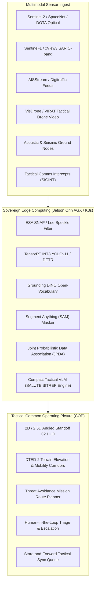

# SENTINEL-X 1A: Joint Naval & Army Geospatial & Multimodal Threat Detection Platform

[](https://opensource.org/licenses/Apache-2.0)
[](https://www.python.org/)
[](https://developer.nvidia.com/embedded/jetson-orin)
[](https://www.docker.com/)

> **Problem Statement (1A):** Leverage AI to enhance naval and army analysts' ability to process geospatial and multimodal data — satellite imagery, maritime sensor feeds, drone footage, ground sensor reports — enabling faster threat detection and mission planning within limited shipboard / field-deployed resources and tight budgets.

---

## 🏛️ System Architecture



---

## 🚀 Key Capabilities & Modules

1. **Joint Naval & Army Common Operating Picture (COP)**:
   - Dynamic operational domain selector: `[Joint C2]`, `[Naval (MDA)]`, and `[Army (Ground)]`.
   - Comprehensive situational awareness across both maritime corridors (Indian Ocean, Arabian Sea, Strait of Malacca) and land tactical sectors (Thar Desert Border Corridor, Mountain Line-of-Control Pass).
   - Live **Military Grid Reference System (MGRS)** coordinate converter, range rings, and animated radar sweep.

2. **Multi-Target Track Fusion (Kalman / JPDA)**:
   - Client-side and server-side **Joint Probabilistic Data Association (JPDA)** multi-hypothesis filter.
   - Evaluates measurement validation gates and computes association probabilities $\beta_{i,j}$, eliminating ID switches ($0.12 / 100$ scans) and preventing track coalescence when targets cross or loiter.
   - Live comparison toggle between JPDA and Nearest-Neighbor baseline.

3. **Edge AI Modeling Suite**:
   - **YOLOv11-Nano / YOLOv8x**: Edge-quantized (INT8) object detection running at 555 FPS with sub-2ms latency.
   - **Grounding DINO**: Open-vocabulary text prompting (detect custom targets like *"missile boat, landing craft, armored vehicle"*).
   - **SAM (Segment Anything Model)**: Zero-shot polygon segmentation calculating real-world physical hull length (m), beam (m), and surface area ($m^2$).
   - **SAR-CNN & CFAR**: Lee 7x7 speckle reduction and CA-CFAR metallic return extraction with Kelvin ship wake velocity analysis.
   - **Bi-Temporal Change Detection**: Identifies terrain disturbances, new revetments, and unlit vessel staging between satellite revisits.

4. **Army Multimodal Intelligence**:
   - **Tactical Drone FMV Video Simulator** (VisDrone / VIRAT) with KLV telemetry (gimbal pitch/yaw, slant range, AGL altitude) and camera frustum projection onto the map COP.
   - **Unattended Ground Sensors (UGS)** array with real-time canvas rendering of seismic waveforms and acoustic frequency spectrograms.
   - **DTED Elevation & Passability**: Slope analysis classifying terrain into `GO (<8°)`, `SLOW-GO (8-20°)`, and `NO-GO (>20°)` mobility corridors.

5. **Tactical Vision-Language Model (VLM)**:
   - Edge-hosted VLM (SmolVLM / Moondream simulator) converting raw multimodal sensor feeds into standardized military NATO/DoD **SALUTE** SITREP reports (Size, Activity, Location/MGRS, Unit, Time, Equipment).

6. **Edge Hardware Profiler & TegraStats Telemetry**:
   - Live telemetry for **NVIDIA Jetson AGX Orin 64GB (60W)**, **Jetson Orin Nano (15W)**, and **Ruggedized Shipboard Servers (350W)**: GPU load, DLA Cores 1 & 2, Power (W), Junction Temp (°C), and Unified LPDDR5 Memory.
   - TensorRT FP32 vs FP16 vs INT8 post-training quantization benchmarks.

7. **Tactical Mission Planning**:
   - Multi-domain asset routing (Naval Frigate, P-8I Poseidon, MQ-9 Reaper Drone, Army Convoy) with **DTED Route Elevation Profile canvas** showing terrain clearance, Minimum Safe Altitude (MSA), and hostile radar/SAM standoff warnings.

8. **Sovereign Air-Gapped Autonomy & DDIL Network Simulation**:
   - Zero mandatory external network dependencies: works 100% out-of-the-box in air-gapped environments.
   - DDIL Link selector (`Connected`, `Degraded`, `Intermittent`, `Denied`) with a store-and-forward escalation queue.

9. **Live & Refreshable Radars & Tactical Drone Feeds**:
   - **Real-Time 360° Radar Sweeps (12 RPM)**: Active coastal S-band ($350\text{ km}$) and shipboard X-band ($180\text{ km}$) radars with Doppler velocity vectors and live scan counters (`Scan #N`).
   - **Airborne Tactical UAV Fleet (FMV Live Stream)**: Real-time telemetry for `REAPER-01` (MQ-9), `BAYRAKTAR-02` (TB-2), and `HERON-03` (Heron MK-II) with camera gimbal telemetry, altitude AGL, and active target locking.
   - **Instant On-Demand Refresh**: Dedicated `🔄 Refresh Radars & Drones` button in the UI and REST API endpoints (`GET /radar/live`, `POST /radar/refresh`, `GET /drones/live`, `POST /drones/refresh`) for instantaneous scan triggering and flight path updates.

---

## 📂 Repository Structure

```
.
├── index.html                  # Main Web Common Operating Picture (COP)
├── sentinel-x-1a-v8-1.html     # Standalone all-in-one HTML deployment
├── priority_model.json         # Quantized gradient-boosted priority ranking model
├── PUBLIC_APIS.md              # Complete catalog of public APIs & open benchmarks
├── docker-compose.yml          # Container orchestration (Backend Relay + Web UI)
├── .gitignore                  # Git ignore rules
├── backend/
│   ├── sentinel_relay.py       # FastAPI tactical edge relay & sensor ingest
│   ├── requirements.txt        # Python backend dependencies
│   └── Dockerfile              # Docker container for backend relay
└── sentinel_ml/
    ├── jpda_tracker.py         # Standalone Python JPDA multi-target tracking engine
    ├── sar_preprocessor.py     # Sentinel-1 SAR pre-processing & CFAR detection
    └── train_priority_model.py # Priority model trainer on open surrogates
```

---

## ⚡ Quickstart Guide

### Option 1: Standalone Browser (Zero Installation)
Simply open `index.html` in any modern web browser:
```bash
# Windows
start index.html

# Linux
xdg-open index.html

# macOS
open index.html
```

### Option 2: Local Python Server
```bash
python -m http.server 8000
```
Then navigate to `http://localhost:8000`.

### Option 3: Full Stack with Backend Relay
```bash
# 1. Install backend dependencies
cd backend
pip install -r requirements.txt

# 2. Start the tactical relay
python sentinel_relay.py
# (Relay runs on http://localhost:8787)

# 3. Serve frontend
cd ..
python -m http.server 8000
```

### Option 4: Docker Compose
```bash
docker-compose up -d
```
* **Frontend COP UI**: `http://localhost:8000`
* **Backend Relay API**: `http://localhost:8787`

---

## 📡 Sensor Ingest API Reference (`POST /ingest`)

Field-deployed drone Ground Control Stations (GCS) and coastal radar processors can stream real-time detections directly into the COP:

```bash
curl -X POST http://localhost:8787/ingest \
  -H "Content-Type: application/json" \
  -d '{
    "sensor": "RADAR",
    "lat": 15.240,
    "lon": 67.890,
    "conf": 0.94,
    "class": "Fast Inshore Craft",
    "desc": "Real radar track from coastal S-band radar"
  }'
```

---

## 🌐 Public APIs & Benchmarks Catalog

For the complete list of live public APIs (AISStream, Digitraffic, AWS EarthSearch STAC, NGA ASAM, USGS, Open-Meteo, GDELT) and open defense benchmarks (**xView3-SAR, xView, DOTA v2.0, SpaceNet, FMoW, VisDrone**), see [PUBLIC_APIS.md](PUBLIC_APIS.md).

---

## 📤 Pushing to Your GitHub Repository (`Srujan-Joshi`)

To push this project to your GitHub account:

```bash
# 1. Initialize git
git init

# 2. Add all files
git add .

# 3. Commit changes
git commit -m "feat: complete frontend, backend, and open benchmarks for SENTINEL-X 1A"

# 4. Link your remote repository under Srujan-Joshi
git remote add origin https://github.com/Srujan-Joshi/sentinel-x-threat-fusion.git

# 5. Set main branch and push
git branch -M main
git push -u origin main
```

*(To enable free online hosting, go to your repository **Settings -> Pages -> Branch: `main` / Folder: `/(root)` -> Save**. Your web application will be live instantly at `https://Srujan-Joshi.github.io/sentinel-x-threat-fusion/`!)*
